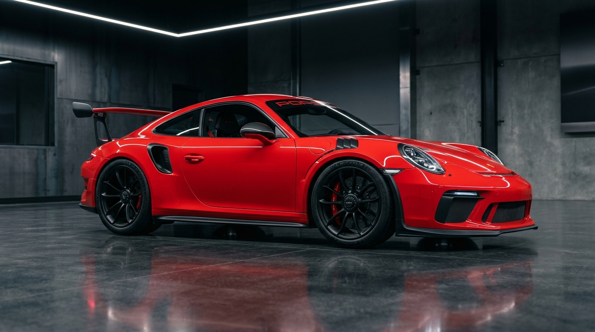

# PORSCHE – THE ART OF PERFORMANCE

A world-class, premium, highly interactive automotive digital experience showcasing Porsche's pinnacle lineup, verified Indian pricing in INR (₹), real-time interactive 3D WebGL showroom, 1948 heritage chronology, and full test-drive reservation system.



---

## 🌟 Key Features

### 1. Cinematic Hero Experience
- Full-screen opening showcase featuring the **Porsche 911 GT3 RS** in a dark studio setting.
- Dynamic Web Audio API synthesizer reproducing the visceral 9,000 RPM naturally aspirated Flat-6 boxer roar.
- Direct quick navigation to models and test-drive booking.

### 2. Seven Flagship Porsche Models
Each model features authentic high-resolution studio photography, 0–100 km/h acceleration benchmarks, top speeds, power figures, and Indian ex-showroom prices:
1. **Porsche 911 GT3 RS** – 4.0L NA Boxer 6 (525 PS, 0–100 in 3.2s) · *₹3.51 Crore*
2. **Porsche 911 Carrera GTS** – 3.6L T-Hybrid (541 PS, 0–100 in 3.0s) · *₹2.75 Crore*
3. **Porsche 718 Cayman GT4 RS** – 4.0L Mid-Engine Flat-6 (500 PS, 0–100 in 3.4s) · *₹2.54 Crore*
4. **Porsche Taycan Turbo GT** – Dual Electric Motors with Attack Mode (1,108 PS, 0–100 in 2.2s) · *₹3.11 Crore*
5. **Porsche Cayenne Turbo GT** – 4.0L Twin-Turbo V8 (659 PS, 0–100 in 3.3s) · *₹2.70 Crore*
6. **Porsche Panamera Turbo E-Hybrid** – 4.0L V8 PHEV (680 PS, 0–100 in 3.2s) · *₹2.34 Crore*
7. **Porsche 911 Dakar** – 3.0L Twin-Turbo All-Terrain Rallye (480 PS, 0–100 in 3.4s) · *Collector Allocation*

### 3. Dedicated India Pricing & Dealerships
- Verified starting ex-showroom prices in Indian Rupees (₹).
- Last-verified manufacturer records notice (**October 2026**).
- Authorized Porsche Centres across **Bengaluru, Mumbai, Delhi NCR, Chennai, Hyderabad, Pune, and Kochi**.
- Model comparison tool for side-by-side performance metrics.

### 4. Interactive 3D WebGL Car Experience ("Beyond the Ordinary")
- 3D Porsche 911 GT3 RS model built with Three.js.
- 360-degree rotation, zoom controls, and camera presets (*Front 3/4, Profile Side, Rear Aero, Top Down*).
- Real-time PBR exterior paint configurator (*Guards Red, GT Silver Metallic, Racing Yellow, Shark Blue, Deep Obsidian Black, Carrara White*).
- 5 interactive technical hotspots (*Swan-Neck DRS Wing, Ceramic PCCB Brakes, 9,000 RPM Boxer Engine, CFRP Contoured Roof, Double-Wishbone Front Axle*).
- Collapsible Zen View bottom dock respecting viewport clarity.

### 5. Porsche Performance Pillars
- **Performance**: High-revving motorsport powertrains, PDK dual-clutch transmission, active rear-axle steering, and Porsche Active Ride.
- **Design**: Iconic 1963 flyline, active aerodynamics, lightweight Weissach carbon components, and LED matrix lighting.
- **Technology**: Curved HD OLED cockpit, 800V fast-charging infrastructure, and telemetry tracking.

### 6. Porsche Heritage Timeline (Since 1948)
- Archival museum photo of the original **1948 Porsche 356 No. 1 Roadster**.
- Interactive milestones: *1931 Stuttgart founding, 1948 356 birth, 1963 iconic 911 launch, 1974 Turbo era, 1986 Paris-Dakar 959, and Modern Le Mans 19 victories / EV innovation*.

### 7. Concierge Test-Drive Booking
- Real-time form validation (name, email, 10-digit Indian mobile number, preferred date, time slot, model, and designated city).
- Instant dossier reference generation (`POR-IN-XXXXXX`).
- Calendar `.ics` appointment export.

---

## 🛠️ Technology Stack

- **Framework**: React 19 + TypeScript
- **Bundler**: Vite
- **Styling**: Tailwind CSS v4 with custom luxury automotive typography (`Outfit` & `Plus Jakarta Sans`)
- **3D Graphics**: Three.js (WebGL PBR with `RoomEnvironment` PMREM reflections)
- **Audio**: Web Audio API procedural synthesis (zero external audio file dependencies)
- **Icons**: Lucide React
- **Deployment**: GitHub Pages & GitHub Actions

---

## 🚀 Local Development Setup

Follow these steps to run the project locally on your machine:

```bash
# 1. Clone the repository
git clone https://github.com/your-username/porsche-art-of-performance.git
cd porsche-art-of-performance

# 2. Install all dependencies
npm install

# 3. Start the development server
npm run dev
```

Open [http://localhost:3000](http://localhost:3000) in your browser.

---

## 📦 GitHub Pages Deployment Guide

This project is pre-configured for one-click deployment to **GitHub Pages** via the included GitHub Actions workflow (`.github/workflows/deploy.yml`).

### Step-by-Step Deployment:

1. **Push your code to GitHub**:
   ```bash
   git add .
   git commit -m "feat: world-class porsche automotive showcase"
   git push origin main
   ```

2. **Enable GitHub Pages in your repository settings**:
   - Go to your repository on GitHub.
   - Click on **Settings** > **Pages** (under the "Code and automation" section).
   - Under **Build and deployment**:
     - **Source**: Select `GitHub Actions`.

3. **Verify the Automated Deployment**:
   - Navigate to the **Actions** tab on your GitHub repository.
   - The `Deploy Porsche Showcase to GitHub Pages` workflow will run automatically and deploy your site.
   - Once completed, your live URL will be shown on the GitHub Pages settings page (e.g. `https://your-username.github.io/your-repo-name/`).

---

## ⚖️ Disclaimer

This website is an **independent concept presentation and automotive design study**. It is not an official website of Dr. Ing. h.c. F. Porsche AG or Porsche India. All trademarks, model names, badges, and designs are intellectual property of Dr. Ing. h.c. F. Porsche AG.
